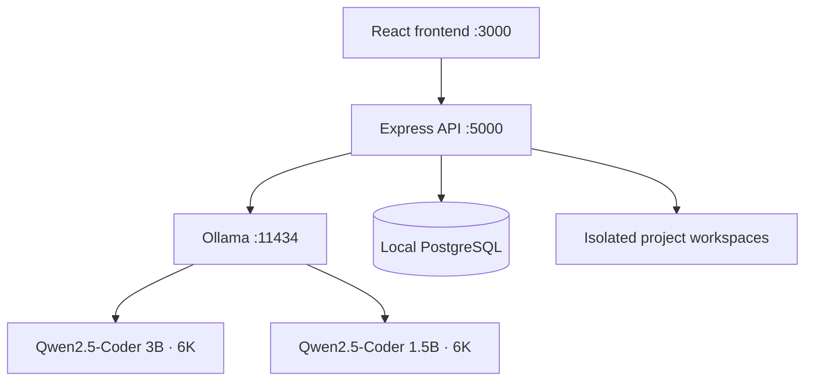

# Taifa AI

**A local-first, approval-driven AI coding environment.**

Taifa AI is an AI-assisted development environment that combines a React interface, a Node.js/Express backend, local Ollama inference, and PostgreSQL-backed project state. It is designed to help developers understand a codebase, plan changes, generate code, and verify proposed work while keeping execution under human control.

> **AI proposes. The developer reviews. Consequential actions require approval.**

## Why Taifa AI

Taifa AI explores a practical alternative to cloud-dependent coding assistants: run inference locally, keep project workspaces and context on the developer's device, and make proposed changes inspectable before they are applied.

The project is also developed and tested in Termux on Android, with resource constraints in mind.

## Architecture



| Layer | Responsibility |
|---|---|
| React frontend | Chat, project navigation, and review panels |
| Express backend | Authentication, orchestration, validation, and controlled execution |
| Ollama | Local model inference |
| PostgreSQL | Project memory, conversation history, plans, and campaign state |
| Local filesystem | Project workspaces, indexes, dependency graphs, and backups |

Two custom Ollama models are created from the supplied Modelfiles. The 3B model handles code generation, planning, tests, and documentation. The 1.5B model is used for free-form chat and commit-message drafting. Both use a 6,144-token context window.

Project indexes and dependency graphs are rebuildable caches derived from workspace files; PostgreSQL stores durable application state.

## Core capabilities

- **Project-aware context:** indexes workspace files and builds import, component, function/route, and database-schema context.
- **Code proposals:** generate new files, targeted edits, and fixes with reviewable diffs.
- **Multi-file planning:** break larger tasks into batches, with fresh indexing between batches.
- **Human-defined architecture:** developers provide the file-level architecture; the model works against those explicit instructions rather than autonomously inventing an entire application.
- **Verification pipeline:** syntax, import, lint, test-suite, route-regression, package metadata, and deterministic code checks.
- **Project memory:** retain project facts, conversation history, plans, and campaign outcomes.
- **Session isolation:** separate project workspaces, state, file watchers, and conversation history by user and project.
- **Local learning chat:** maintain learning conversations separately from project conversations.
- **Controlled tools:** read-only Git inspection, approval-gated commits, and validated package installation.

## Approval model

Taifa AI separates proposal generation from execution:

1. A developer enters an explicit command.
2. The model prepares a proposal.
3. Applicable mechanical checks run.
4. The developer inspects the proposal and diff.
5. The developer approves or rejects the action.

File writes, edits, fixes, plans, generated tests, commits, and package installations are subject to explicit approval. Model output alone does not authorize execution.

## Technology

- **Frontend:** React 19, Create React App
- **Backend:** Node.js, Express 5
- **Inference:** Ollama
- **Models:** Qwen2.5-Coder 3B and 1.5B, using custom 6K Modelfiles
- **Database:** PostgreSQL
- **Authentication:** local username/password accounts, bcryptjs, JWT
- **Validation:** Babel Parser, ESLint, and project-specific deterministic checks
- **Filesystem monitoring:** Chokidar

## Getting started

### Prerequisites

Install Node.js, npm, PostgreSQL, Ollama, and Git.

### 1. Clone the repository

```bash
git clone https://github.com/Shelby6898/taifa-ai.git
cd taifa-ai
```

### 2. Download and create the local models

Run these commands from the repository root:

```bash
ollama pull qwen2.5-coder:3b
ollama pull qwen2.5-coder:1.5b

ollama create qwen2.5-coder-3b-6k -f Modelfile-3b
ollama create qwen2.5-coder-6k -f Modelfile
```

### 3. Create the PostgreSQL database

```bash
createdb taifa_ai
psql -d taifa_ai -f backend/schema.sql
```

By default, the backend connects to PostgreSQL at `127.0.0.1:5432`, using database `taifa_ai` and the current operating-system user. You can override the connection with `PGHOST`, `PGPORT`, `PGDATABASE`, and `PGUSER`.

### 4. Configure the backend

Create `backend/.env` and set a random JWT secret of at least 32 characters:

```env
JWT_SECRET=replace_with_a_random_secret
```

Generate a suitable value with:

```bash
openssl rand -hex 32
```

Keep `backend/.env` and local account data private. User accounts are stored locally in `backend/data/users.json`; passwords are hashed with bcryptjs.

### 5. Install dependencies

In the repository root:

```bash
cd backend
npm install
```

In a separate terminal:

```bash
cd frontend
npm install
```

### 6. Start the services

Start Ollama:

```bash
ollama serve
```

Start the backend:

```bash
cd backend
npm start
```

Start the frontend in another terminal:

```bash
cd frontend
npm start
```

Open [http://localhost:3000](http://localhost:3000), create a local account or sign in, then select or create a project.

## Command interface

Examples of supported commands:

| Command | Purpose |
|---|---|
| `write to: path.js | instruction` | Propose a new file |
| `edit: path.js | instruction` | Propose a targeted edit |
| `fix this: <error>` | Investigate and propose a fix |
| `plan: <description>` | Propose a multi-file plan |
| `execute plan: <description>` | Supply a human-defined file plan |
| `write tests: path.js` | Generate a test proposal |
| `run tests` | Run the workspace test suite |
| `document` | Generate workspace documentation |
| `remember: <fact>` | Store a project fact |
| `git status` / `git diff` | Inspect Git state |
| `commit changes` | Prepare an approval-gated commit |
| `install: <package>` | Prepare a validated, approval-gated install |

For `execute plan:`, follow the description with one `path: description` line per file.

## Verification and safety

The project uses deterministic checks where possible instead of treating model self-review as a security boundary.

- File operations are scoped to the resolved project workspace.
- Path traversal and symlink escapes are checked before proposed writes and again at apply time.
- Existing files are backed up before overwrite.
- Multi-file application halts if a path-safety check fails.
- Tool execution uses fixed executables and argument lists rather than shell command strings.
- Package names are validated before npm installation.
- Git commits are blocked when risky generated or vendor content is detected in the proposed staging set.
- Generated tests are checked for module-system mismatches.
- Route-regression and package metadata checks help catch common cross-file failures.
- Pending actions and conversation history can be restored after a browser refresh.

These controls reduce risk; they do not make generated code inherently correct. Review every diff and run the relevant tests before accepting changes.

## Testing

Run backend unit tests:

```bash
cd backend
npm test
```

Run backend integration tests:

```bash
npm run test:integration
```

Build the frontend:

```bash
cd frontend
npm run build
```

## Repository layout

```text
taifa-ai/
├── backend/       # API, authentication, inference orchestration,
│                  # validation, tools, persistence, and tests
├── frontend/      # React application
├── docs/          # Project documentation
├── scripts/       # Development and maintenance scripts
├── models/        # Local model-related assets
├── Modelfile      # 1.5B model configuration
├── Modelfile-3b   # 3B model configuration
└── README.md
```

## Known limitations

- Small local models are useful for scoped tasks but can lose cross-file consistency or fail to follow detailed instructions.
- Generated documentation and tests can contain incorrect assumptions; inspect them carefully.
- SEARCH/REPLACE edits can fail when model-generated match text is not an exact match for the source. Failed blocks are reported for review.
- Large workspaces can exceed the available context budget; the indexer reports when context is truncated.
- The first request after an idle watcher has been closed may incur re-indexing work.
- Initial model and dependency downloads require internet access. Local inference itself uses Ollama rather than a hosted AI API.

## Project status

**Active development.** The project has completed its seven documented development phases, including the shift to human-supplied architecture, session isolation, refresh recovery, and PostgreSQL-backed persistence. Ongoing work focuses on improving reliability, validation coverage, and the developer experience.

---

Built by **Taifatech Solutions**.
